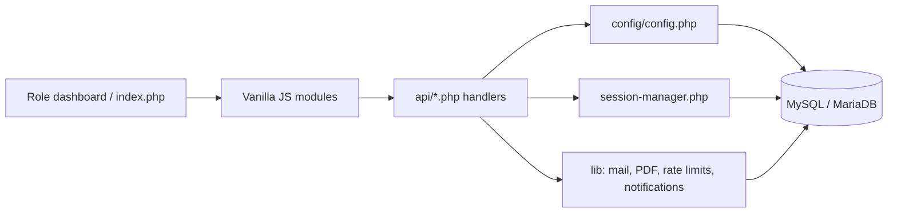

# Architecture Assessment

## Current design

Vuka is a server-rendered PHP application with a modest REST-like API layer. `index.php` and the four role dashboards render HTML; vanilla JavaScript modules issue JSON or multipart `fetch` requests. Most endpoints contain their own validation, SQL, business logic, response generation, and side effects. Shared infrastructure is included procedurally through `config/config.php`, `session-manager.php`, `audit-logger.php`, and utility files under `lib/`.

This is a shared-utility/procedural architecture with MVC-like separation between pages and APIs, but not a full MVC or service architecture. It is reasonable for the current footprint if endpoint boundaries are made secure and contracts are documented. The audit does not recommend a framework rewrite.

## Request and data flow

## Strengths

- Small dependency footprint; ordinary PHP hosting is sufficient.
- PDO is shared and configured to throw on database errors, use associative results, and disable emulated prepares.
- Shared session/role helpers exist, and core tables are separated by responsibility.
- UI modules are divided by role and a few shared cross-dashboard behaviors are centralized in `assets/js/common.js`.
- Upload handling, evaluation submission, interview scheduling, and application submission use transactions in several paths.

## Maintainability and reliability weaknesses

1. **Authorization is opt-in and inconsistent.** A file can include the configuration and perform work without calling a role guard. The submission read and update endpoints demonstrate this. No common router or middleware forces an authorization decision.
2. **Business logic is duplicated.** Login exists in universal, admin-specific, and student-specific endpoints; admin listings overlap; profile/user information is exposed through multiple endpoints. Session creation differs between the three login paths.
3. **Response contracts vary.** `json_response` wraps and mirrors payload fields; some endpoints emit raw JSON, some return binary, and some use `error` while others use `message`. Frontend scripts consequently depend on different response shapes.
4. **Error handling is uneven.** Some endpoints catch `Exception` and return details; many catch only exceptions while PHP `Error`/`Throwable` can produce empty 500s. Several scripts have no method check, buffering discipline, or common error mapping.
5. **SQL and business rules live in endpoint bodies.** Status transition validation, department scope, validation, audit, email, and notifications are repeated or omitted by individual endpoints.
6. **Implicit global state.** APIs depend on global `$pdo`, `$GLOBALS['sessionManager']`, constants, and included functions. This obscures dependencies and makes isolated testing harder.
7. **Configuration concerns are coupled.** The bootstrap parses a limited `.env` syntax itself, creates a database connection on every include, defines response/auth/password helpers, and defines upload/mail settings in one file.

## Coupling and duplication

- `api/login.php`, `api/admin-login.php`, and `api/student-login.php` each verify credentials and create DB sessions. Only the student endpoint uses `SessionManager::createSession`; the other paths insert directly.
- `api/get-admin-accounts.php` and `api/get-admins.php` both list administrators; `get-profile.php` and `get-user-info.php` both expose account details with different field contracts.
- `assets/js/common.js` (1,509 lines) combines unrelated shared functions, API calls, profile handling, notification polling, review flows, and CSV behavior; role modules also perform their own requests.
- DB schema fields are duplicated between normalized department IDs and free-text department columns, and between account data and submission identity snapshots.

## Recommended direction (no changes in this phase)

- Keep PHP/vanilla JS for near-term work. Add thin shared request/auth helpers and small service functions only where they reduce duplicated authorization/business rules.
- Establish a documented endpoint contract (method, auth, input, output, side effects) and common exception handling.
- Centralize session creation and required role/scope checks without changing existing routes or response contracts abruptly.
- Use explicit database migrations after the current schema and local instance are reconciled.
- Add automated tests around endpoint authorization and workflow transitions before refactoring broader structure.

## Evidence limits

This was static source inspection plus safe syntax checks. No runtime tracing, dependency vulnerability scan, load testing, or full browser interaction was performed.
