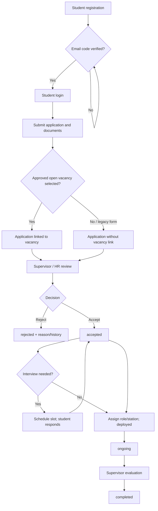
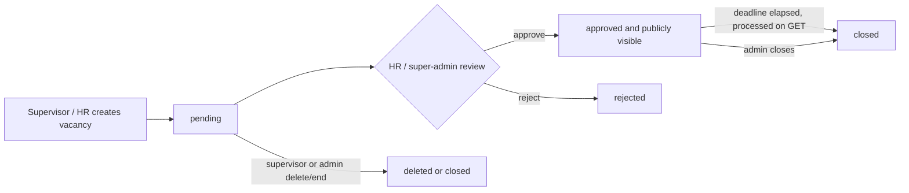

# Business Workflow Assessment

## Evidence boundary

The workflow below reflects implemented endpoint and schema behavior. The README describes a four-role attachment/internship process; no institutional policy documents, operating procedures, or stakeholder interviews were available. Where the code does not define a business rule, this report marks it as unspecified rather than inventing one.

## Student application and placement

1. A student submits registration details; `api/register.php` validates National ID shape, email, domain allowlist, and a minimum password length, then stores a password hash and a verification code.
2. The student confirms a code through `api/verify-email.php`; registration can also resend a code. Email uses `lib/mailer.php`, which may log instead of deliver.
3. Login is available through universal `api/login.php` or student-specific `api/student-login.php`.
4. A form posts student identity and application data plus files to `api/submit-application.php`. The endpoint looks up an account by submitted National ID, blocks a second existing submission for that user, optionally checks that a vacancy is approved and before deadline, then stores submission and document BLOBs in a transaction.
5. Admins list/review submissions; status updates are handled by `api/update-submission.php`, with review history and in-app/email notifications. The endpoint’s current auth and transition checks are insufficient; see the security report.
6. Admins can schedule interview slots. Students respond confirmed/conflict. Evaluation can be submitted by a supervisor for an ongoing/completed application and the evaluation endpoint moves the submission to `completed`.
7. The schema supports `deployed`, `ongoing`, and `completed`, plus assignment fields. No distinct attendance/progress log or commencement workflow was found.

The diagram shows intended relationships; the source does not enforce all transitions. In particular, status updates accept a broad list of states without validating a prior-state/next-state matrix.

## Vacancy workflow

1. Any admin-tier user can create a vacancy; supervisors’ department is derived from their session, while HR/super-admin may supply a department.
2. New records start `pending`.
3. HR/super-admin can update status; approved vacancies are publicly listed by default.
4. A GET request to `api/vacancies.php` also closes expired approved records as a side effect.
5. A supervisor may delete/end a vacancy only when the free-text department matches their own. HR/super-admin can operate across departments.

## Implemented state vocabularies

- Submission `status`: `not_applied`, `applied`, `pending`, `accepted`, `rejected`, `deployed`, `ongoing`, `completed`, `withdrawn`, `interview` (plus compatibility mapping for `pending_review` and `approved` in one endpoint).
- Parallel `placement_status`: `pending`, `shortlisted`, `selected`, `placed`, `rejected`.
- Vacancy: `pending`, `approved`, `rejected`, `closed`.
- Interview slot: `scheduled`, `rescheduled`, `confirmed`, `completed`, `cancelled`.

## Gaps and unresolved institutional decisions

- Public form submission is described as intentional, but identity is selected by submitted National ID and there is no session ownership proof; institutional policy must confirm whether accountless applications are allowed and how identity is verified.
- “One application per user” in code is broader than vacancy-specific application; there is no unique database constraint and the exact business rule is not documented.
- No authoritative transition table specifies whether review, rejection, withdrawal, deployment, or completion may be reversed.
- Placement status is parallel to application status but no consistent mapping/transitions are enforced.
- Supervisor assignment, placement start, attendance, progress reporting, and completion sign-off are not represented as a complete workflow.
- Vacancy deletion permanently removes the row; archival/impact on associated submissions is unspecified.
- Interview scheduling can set submission status to `interview`; cancellation restores `accepted`. Other reschedule/completion outcomes need business confirmation.
- Email failures are best-effort/log-only; no delivery state, retries, or outbox guarantee exists.
