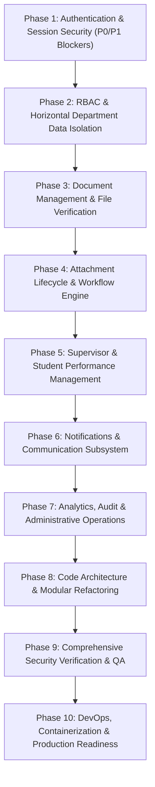

# Master Implementation Roadmap (Phases 1 – 10)

**Project:** Vuka Attachment & Internship Portal  
**Document Purpose:** Prioritized, phase-by-phase engineering execution plan for enterprise-grade modernization, hardening, and institutional deployment.

---

## Roadmap Executive Overview

---

## Phase 1: Authentication and Session Security (Priority: P0 — Critical)

* **1. Objectives:**
  Eliminate all critical authentication bypasses, unify session creation across all entry points, repair schema-mismatched password endpoints, and eliminate token leaks in logs and responses.
* **2. Existing Problems Addressed:**
  - Finding SEC-02 (`api/update-submission.php` unauthenticated status modification).
  - Finding SEC-03 (Seeded default administrative credentials in documentation and database).
  - Finding SEC-04 (`api/register.php` debug verification code leakage).
  - Finding SEC-05 (`logs/mail.log` password reset token leakage).
  - Finding SEC-06 (`debug.log` session token and authorization header logging).
  - Finding SEC-08 (`api/change-password.php` query against nonexistent `password` column).
  - Session creation divergence between `login.php`, `admin-login.php`, and `student-login.php`.
* **3. Exact Files Likely to Require Changes:**
  - `api/login.php`
  - `api/admin-login.php`
  - `api/student-login.php`
  - `api/register.php`
  - `api/change-password.php`
  - `api/forgot-password.php`
  - `api/reset-password.php`
  - `session-manager.php`
  - `lib/mailer.php`
  - `.htaccess`
* **4. Dependencies:**
  None (Foundational Phase).
* **5. Database Changes Anticipated:**
  - Forward-only migration altering `sessions` table to add `DEFAULT CURRENT_TIMESTAMP` to `created_at` and `last_activity`.
  - Migration hashing reset tokens (`SHA-256`) in `password_reset_tokens` instead of plaintext storage.
  - Deletion or reset of default seeded super-admin password.
* **6. Implementation Tasks:**
  1. Refactor `api/login.php` and `api/admin-login.php` to delegate session generation exclusively to `SessionManager::createSession()`.
  2. Fix `api/change-password.php` to query and update `password_hash`.
  3. Strip `debug_code` from all `api/register.php` response payloads.
  4. Move `logs/` outside the web root or add an Apache `.htaccess` denying all HTTP access.
  5. Remove raw token interpolation from error logging in `session-manager.php`.
  6. Require password rotation on first login for the default Super Admin account.
* **7. Security Requirements:**
  - All authenticated sessions must have verified records in `sessions` with valid expiry.
  - Rate limiting must bind consistently across all login endpoints.
* **8. Testing Requirements:**
  - Automated integration tests asserting that invalid passwords, expired tokens, and unverified accounts fail authentication with HTTP 401.
  - Assert `debug_code` is absent from registration responses.
* **9. Acceptance Criteria:**
  - All 3 login endpoints delegate to unified session creation.
  - Password change and reset flows complete successfully without database exceptions.
  - No secret tokens appear in logs or public responses.
* **10. Risks:**
  - Potential disruption to local test scripts relying on `debug_code` for automated registration testing.

---

## Phase 2: RBAC and Data Isolation (Priority: P0 — Critical)

**Implementation status:** Phase 2 authorization remediation is implemented on `feature/phase-2-rbac-data-isolation` and awaits review/merge. See [`docs/implementation/phase-2/IMPLEMENTATION-REPORT.md`](../../implementation/phase-2/IMPLEMENTATION-REPORT.md). The remaining roadmap bullets below are historical findings and should not be read as current defects without re-auditing the branch.

* **1. Objectives:**
  Enforce strict server-side authorization guards across every API endpoint and guarantee impenetrable horizontal department data isolation.
* **2. Existing Problems Addressed:**
  - Finding SEC-01 (`api/get-submissions.php` unauthenticated PII disclosure).
  - Finding SEC-02 (`api/update-submission.php` bypass of session verification via caller PF).
  - Inconsistent role verification across student and administrative dashboards.
* **3. Exact Files Likely to Require Changes:**
  - `api/get-submissions.php`
  - `api/update-submission.php`
  - `api/get-users.php`
  - `api/get-admins.php`
  - `api/get-admin-accounts.php`
  - `api/create-admin-account.php`
  - `api/activate-admin-account.php`
  - `api/deactivate-admin-account.php`
  - `session-manager.php`
* **4. Dependencies:**
  Phase 1 (Secure Session Foundation).
* **5. Database Changes Anticipated:**
  - Reconcile schema columns in `admin_users` (`activated_at`, `activated_by`, `updated_by`) and `admin_creation_history` (`activated_at`, `activation_by_admin_id`, `deactivated_at`, `deactivation_reason`).
  - Add composite index on `submissions (department_applied, status, submitted_at)`.
* **6. Implementation Tasks:**
  1. Add mandatory `requireAnyAdmin()` check to `api/get-submissions.php` before processing `?id=` or `?department=`.
  2. Enforce strict `requireAnyAdmin()` in `api/update-submission.php` and bind `$pfNumber` and `$department` strictly from `$session`.
  3. Ensure Department Supervisors can NEVER view or mutate candidates from outside their department.
  4. Fix column names in admin activation and deactivation scripts to match the schema.
* **7. Security Requirements:**
  - Zero unauthenticated endpoints under `api/` that return applicant PII or mutate database state.
* **8. Testing Requirements:**
  - Test matrix verifying each role (Student, Supervisor, HR, Super Admin) against all 46 endpoints to assert correct 200, 401, or 403 responses.
* **9. Acceptance Criteria:**
  - An anonymous GET to `api/get-submissions.php?id=1` returns HTTP 401 Unauthorized.
  - A supervisor from "Health" attempting to update an "ICT" submission receives HTTP 403 Forbidden.
* **10. Risks:**
  - Department naming discrepancies (e.g. "HR" vs "Human Resources") could inadvertently lock supervisors out if string matching is inconsistent.

---

## Phase 3: Document Management and Verification (Priority: P1 — High)

* **1. Objectives:**
  Secure document upload and download endpoints, resolve student document access restrictions, and prevent MIME/XSS injection vulnerabilities.
* **2. Existing Problems Addressed:**
  - Finding SEC-07 (Unauthenticated submission on behalf of third parties).
  - Student lockout on document downloads (`api/download-document.php` restricted to admins only).
  - Inline document delivery without sandbox CSP.
* **3. Exact Files Likely to Require Changes:**
  - `api/submit-application.php`
  - `api/download-document.php`
  - `api/upload-profile-photo.php`
  - `api/serve-profile-photo.php`
  - `api/delete-submission.php`
* **4. Dependencies:**
  Phase 2 (RBAC Framework).
* **5. Database Changes Anticipated:**
  - Add `file_hash` (`CHAR(64)` SHA-256) column to `documents` table for deduplication and tamper detection.
  - Add unique constraint on `submissions (user_id)` to prevent race-condition double applications.
* **6. Implementation Tasks:**
  1. Update `api/submit-application.php` to require an authenticated student session (`requireStudent()`), binding `user_id` and `national_id` from the session.
  2. Update `api/download-document.php` to allow students to download their OWN documents, while maintaining department scoping for admins.
  3. Set `Content-Security-Policy: default-src 'none'; sandbox` and `X-Content-Type-Options: nosniff` on document streaming responses.
* **7. Security Requirements:**
  - Complete prevention of arbitrary file upload, filename header injection, and unauthorized document access.
* **8. Testing Requirements:**
  - Unit tests uploading valid and invalid MIME types (e.g. PHP scripts renamed to `.pdf`).
  - Access tests verifying a student cannot download another student's documents.
* **9. Acceptance Criteria:**
  - Students can successfully download their submitted documents from the student dashboard.
  - Application submission is completely rejected without an active student session.
* **10. Risks:**
  - Large document uploads in environments with low `upload_max_filesize` or `max_allowed_packet` configurations.

---

## Phase 4: Attachment Lifecycle & Workflow Engine (Priority: P1 — High)

* **1. Objectives:**
  Formalize the application state machine, prevent invalid status transitions, and enforce institutional workflow integrity.
* **2. Existing Problems Addressed:**
  - Unrestricted status jumps (e.g. moving directly from `applied` to `deployed`).
  - Inconsistent placement status tracking.
  - Lack of withdrawal guards once reviews have commenced.
* **3. Exact Files Likely to Require Changes:**
  - `api/update-submission.php`
  - `api/bulk-update-submissions.php`
  - `api/withdraw-application.php`
  - `api/vacancies.php`
  - `assets/js/supervisor_dashboard.js`
  - `assets/js/hr_dashboard.js`
* **4. Dependencies:**
  Phase 2 & Phase 3.
* **5. Database Changes Anticipated:**
  - Add state transition table or ENUM constraints for formal lifecycle auditing.
* **6. Implementation Tasks:**
  1. Implement a server-side state transition validator:
     `applied -> pending -> accepted -> deployed -> ongoing -> completed` (or `rejected`).
  2. Prevent reversal of `completed` or `rejected` applications without elevated Super Admin authorization.
  3. Harmonize `status` with `placement_status` (`pending -> shortlisted -> selected -> placed`).
* **7. Security Requirements:**
  - Every status change must write an immutable record to `review_history` with reviewer PF and timestamp.
* **8. Testing Requirements:**
  - State machine unit tests attempting valid and invalid state transitions.
* **9. Acceptance Criteria:**
  - Invalid status jumps return HTTP 422 with a descriptive workflow error.
  - Student withdrawal is locked once review notes or interview slots are created.
* **10. Risks:**
  - Legitimate edge cases where an administrator needs to reopen an erroneously rejected application.

---

## Phase 5: Supervisor & Student Performance Management (Priority: P2 — Medium)

* **1. Objectives:**
  Enhance the interview scheduling and intern evaluation workflow, refine PDF generation, and ensure robust score calculations.
* **2. Existing Problems Addressed:**
  - Concurrency in interview slot scheduling.
  - Missing student response conflict resolution workflow.
  - PDF letter and evaluation styling consistency.
* **3. Exact Files Likely to Require Changes:**
  - `api/evaluations.php`
  - `api/generate-evaluation-pdf.php`
  - `api/interview-slots.php`
  - `api/interview-response.php`
  - `assets/js/evaluations.js`
  - `assets/js/interviews.js`
* **4. Dependencies:**
  Phase 4 (Workflow Engine).
* **5. Database Changes Anticipated:**
  - Add check constraints on `evaluations` ensuring criteria scores are strictly between 1 and 5.
* **6. Implementation Tasks:**
  1. Add conflict re-scheduling workflow for supervisors when a student flags an interview conflict.
  2. Validate evaluation submission only when the submission status is `ongoing` or `completed`.
  3. Refactor PDF generation scripts to utilize standardized institutional letterhead layouts.
* **7. Security Requirements:**
  - Ensure evaluation PDFs can only be accessed by the evaluating supervisor, HR, Super Admin, or the subject student.
* **8. Testing Requirements:**
  - Test score bounds (0 and 6 must be rejected).
  - Verify PDF generation handles special characters in student names without FPDF encoding errors.
* **9. Acceptance Criteria:**
  - Intern evaluation updates submission status to `completed` and issues an email and in-app notification.
  - Generated evaluation PDFs render cleanly with valid score averages and supervisor signatures.
* **10. Risks:**
  - FPDF character encoding limitations when handling UTF-8 characters.

---

## Phase 6: Notifications & Communication Subsystem (Priority: P2 — Medium)

* **1. Objectives:**
  Establish reliable email delivery, eliminate mail log leakage, implement an outbox queue, and harden in-app notifications.
* **2. Existing Problems Addressed:**
  - Synchronous SMTP timeouts blocking web requests.
  - In-app notification deduplication.
  - Elimination of third-party client-side EmailJS dependency.
* **3. Exact Files Likely to Require Changes:**
  - `lib/mailer.php`
  - `lib/notifications.php`
  - `lib/email-templates.php`
  - `api/notifications.php`
  - `assets/js/common.js`
* **4. Dependencies:**
  Phase 1 & Phase 4.
* **5. Database Changes Anticipated:**
  - Create `mail_outbox` table (`id`, `recipient_email`, `recipient_name`, `subject`, `body_html`, `status`, `attempts`, `created_at`, `sent_at`) for asynchronous queuing.
* **6. Implementation Tasks:**
  1. Remove hardcoded EmailJS references from `common.js`.
  2. Implement database-backed mail outbox queue processed by a background worker or cron script.
  3. Ensure transactional emails include unsubscribe / institutional security disclaimers.
* **7. Security Requirements:**
  - Sanitize all notification body text to prevent stored XSS via notification popups.
* **8. Testing Requirements:**
  - Verify email templates render correctly across major email clients (Gmail, Outlook).
  - Test queue retry backoff on SMTP failure.
* **9. Acceptance Criteria:**
  - API responses complete in < 200ms regardless of SMTP connection speed.
  - In-app notifications update in real-time without polling lag.
* **10. Risks:**
  - SMTP relay server rate limits or spam filtering.

---

## Phase 7: Analytics, Audit & Administrative Operations (Priority: P2 — Medium)

* **1. Objectives:**
  Harden the administrative audit trail, implement mandatory server-side pagination, optimize analytics queries, and enforce staff account quotas.
* **2. Existing Problems Addressed:**
  - Missing composite indexes on analytics queries.
  - Concurrency race conditions on department admin caps.
  - Unpaginated large record sets.
* **3. Exact Files Likely to Require Changes:**
  - `api/get-analytics.php`
  - `api/get-audit-log.php`
  - `api/get-dashboard-stats.php`
  - `api/get-admin-accounts.php`
  - `api/create-admin-account.php`
  - `audit-logger.php`
  - `assets/js/admin_dashboard.js`
* **4. Dependencies:**
  Phase 2 (RBAC Framework).
* **5. Database Changes Anticipated:**
  - Add composite index on `audit_logs (created_at, action)`.
  - Transactional isolation on admin user insertions.
* **6. Implementation Tasks:**
  1. Standardize pagination across `get-submissions.php`, `get-audit-log.php`, and `get-users.php` (defaulting to 25 items per page).
  2. Lock department admin creation in a database transaction with `SELECT ... FOR UPDATE` to strictly enforce the 2-admin limit.
  3. Cache dashboard KPI counts using short-lived (5 min) transients or indexed counters.
* **7. Security Requirements:**
  - Audit log records must be append-only and protected against administrative modification or deletion.
* **8. Testing Requirements:**
  - Concurrency tests attempting to create 3 admins simultaneously for the same department.
  - Performance benchmarks for analytics queries with 10,000 mock records.
* **9. Acceptance Criteria:**
  - All admin table views load with server-side pagination pills.
  - Audit log captures 100% of state-changing administrative operations with caller IP, PF, and old/new JSON diffs.
* **10. Risks:**
  - Heavy aggregation queries on older MySQL 5.7 instances without adequate memory buffers.

---

## Phase 8: Code Architecture & Modular Refactoring (Priority: P2 — Medium)

* **1. Objectives:**
  Deconstruct the monolithic `common.js` file, establish unified API response envelopes, introduce PSR-4 autoloading via Composer, and clean up duplicate endpoints.
* **2. Existing Problems Addressed:**
  - Monolithic `assets/js/common.js` (1,509 lines).
  - Redundant API endpoints (`get-admins.php` vs `get-admin-accounts.php`; `get-profile.php` vs `get-user-info.php`).
  - Procedural include dependencies and global state pollution.
* **3. Exact Files Likely to Require Changes:**
  - `assets/js/common.js` -> Split into `utils.js`, `api-client.js`, `theme.js`, `modal.js`.
  - `api/get-admins.php` (Deprecated/redirected to `get-admin-accounts.php`).
  - `api/get-user-info.php` (Consolidated with `get-profile.php`).
  - `composer.json` (Introduce autoloader).
* **4. Dependencies:**
  Phases 1 through 7.
* **5. Database Changes Anticipated:**
  None.
* **6. Implementation Tasks:**
  1. Introduce `composer.json` with PSR-4 namespace mapping (`Vuka\\`).
  2. Split `common.js` into modular ES6 modules or cleanly scoped namespaces.
  3. Deprecate duplicate endpoints with standard backward-compatibility redirects or aliases.
  4. Implement an `escapeHtml()` helper and apply it across all dynamic DOM injection points.
* **7. Security Requirements:**
  - 100% elimination of unescaped `.innerHTML` assignments across the frontend.
* **8. Testing Requirements:**
  - Regression testing on all 4 dashboards to ensure modular JS refactor breaks no existing interactions.
* **9. Acceptance Criteria:**
  - No JavaScript file exceeds 400 lines.
  - Zero DOM-based XSS vulnerabilities detected by static analyzers.
* **10. Risks:**
  - Browser caching of legacy JS files during deployment requiring cache-busting version strings (`?v=4.0`).

---

## Phase 9: Comprehensive Security Verification & QA (Priority: P1 — High)

* **1. Objectives:**
  Conduct end-to-end regression testing, static security analysis (SAST), penetration testing against OWASP Top 10 benchmarks, and KDPA data protection compliance verification.
* **2. Existing Problems Addressed:**
  - Verification that all Phase 1–8 security patches are effective and introduced no secondary defects.
* **3. Exact Files Likely to Require Changes:**
  - Test suites and test fixtures.
  - Security configuration headers (`.htaccess`).
* **4. Dependencies:**
  Phases 1 through 8.
* **5. Database Changes Anticipated:**
  None.
* **6. Implementation Tasks:**
  1. Execute full automated test suite achieving > 85% branch coverage on core authentication and authorization logic.
  2. Run SAST vulnerability scanners (e.g. PHPStan level 8, Psalm, OWASP ZAP).
  3. Conduct simulated penetration tests for IDOR, CSRF, privilege escalation, and session fixation.
  4. Perform data privacy assessment verifying student PII handling against KDPA 2019 guidelines.
* **7. Security Requirements:**
  - Zero Critical (P0) or High (P1) findings unresolved.
* **8. Testing Requirements:**
  - Complete automated and manual test pass with 100% test success.
* **9. Acceptance Criteria:**
  - Formal Phase 9 Security and QA Sign-Off report signed by the engineering audit team.
* **10. Risks:**
  - Discovery of edge-case bugs requiring minor logic revisions in workflow endpoints.

---

## Phase 10: DevOps, Containerization & Production Readiness (Priority: P2 — Medium)

* **1. Objectives:**
  Build reproducible Docker containers, configure GitHub Actions CI/CD pipelines, establish automated backup/restore runbooks, and produce institutional deployment documentation.
* **2. Existing Problems Addressed:**
  - Lack of CI/CD pipeline.
  - Lack of containerization.
  - Absence of disaster recovery and database backup automation.
  - Unpinned CDN assets.
* **3. Exact Files Likely to Require Changes:**
  - `.github/workflows/ci.yml`
  - `Dockerfile`
  - `docker-compose.yml`
  - `.dockerignore`
  - `scripts/backup.sh`
  - `scripts/restore.sh`
  - `README.md`
* **4. Dependencies:**
  Phases 1 through 9.
* **5. Database Changes Anticipated:**
  - Final production database schema baseline with versioned migrations table (`schema_migrations`).
* **6. Implementation Tasks:**
  1. Author multi-stage `Dockerfile` (PHP 8.3 FPM, Alpine Linux, Nginx/Apache, required extensions).
  2. Create `docker-compose.yml` linking web, MySQL 8.4, and local mail server.
  3. Build GitHub Actions pipeline running `composer audit`, `php -l`, PHPStan, and PHPUnit on every commit.
  4. Author automated backup script performing daily encrypted logical dumps.
  5. Pin CDN assets with Subresource Integrity (SRI) hashes or vendor them locally.
* **7. Security Requirements:**
  - Strict HTTPS enforcement, HSTS, Secure/SameSite cookies, and least-privilege database user permissions in production.
* **8. Testing Requirements:**
  - Test cold-start deployment from clean git clone using `docker compose up -d`.
  - Perform test disaster recovery restoration from a backup dump file.
* **9. Acceptance Criteria:**
  - Entire application deploys reproducibly in under 3 minutes via container definition.
  - CI pipeline passes green on all branches.
* **10. Risks:**
  - Hosting environment constraints if deployed on shared cPanel hosting without container support.
