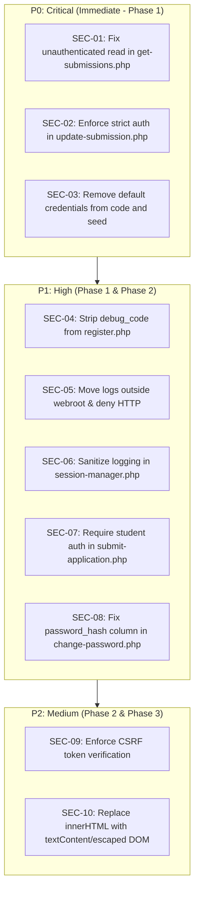

# Comprehensive Security and Compliance Audit

**Audit Scope:** Full repository code, API endpoints, authentication flows, session handling, document management, and deployment configurations at commit `83aa34f`.  
**Standards Applied:** OWASP Top 10 (2021), CWE/SANS Top 25, and the Kenya Data Protection Act (KDPA), 2019.

---

## 1. Executive Security Assessment

The application exhibits several foundational security mechanisms implemented with care:
- Consistent use of PDO prepared statements with native parameter binding across the majority of endpoints, preventing SQL injection.
- Bcrypt password hashing (`PASSWORD_BCRYPT`, cost 10) for stored user and administrator credentials.
- Cryptographically strong 64-character random session tokens generated via `random_bytes(32)`.
- Server-side role and account status re-verification against the database on every authenticated request.
- File upload restrictions employing `finfo` MIME-type validation, extension allowlists, and a 2 MB size cap.
- Direct database BLOB storage for sensitive documents, avoiding public document-root file exposure.

However, the audit revealed **three confirmed Critical (P0) security vulnerabilities** and **six High-Risk (P1) concerns** that undermine access control, expose applicant data, and risk credential/token disclosure.

---

## 2. Confirmed Security Vulnerabilities (Evidence-Based)

### Finding SEC-01: Unauthenticated Information Disclosure & PII Exposure (CRITICAL — P0)
* **Affected File:** `api/get-submissions.php` (Lines 22–57 & 59–86)
* **Vulnerability Type:** CWE-306: Missing Authentication for Critical Function / OWASP A01:2021 – Broken Access Control
* **Evidence:**
  ```php
  // api/get-submissions.php
  $singleId = isset($_GET['id']) ? (int)$_GET['id'] : 0;
  if ($singleId > 0) {
      $stmt = $pdo->prepare("SELECT s.*, COUNT(d.id) as document_count FROM submissions s LEFT JOIN documents d ON s.id = d.submission_id WHERE s.id = ? GROUP BY s.id");
      $stmt->execute([$singleId]);
      $submission = $stmt->fetch();
      ...
      $stmt = $pdo->prepare("SELECT * FROM documents WHERE submission_id = ?");
      $stmt->execute([$singleId]);
      $documents = $stmt->fetchAll();
      json_response(true, ['submission' => $submission, 'review_history' => $reviewHistory, 'documents' => $documents]);
  }
  ```
* **Exploitation Scenario:**
  An anonymous attacker without any credentials or token sends a simple GET request:
  `GET /api/get-submissions.php?id=1`
  The endpoint processes this query and returns the complete application record, including the applicant's full name, National ID, email, institution, course applied for, duration, review notes, internal intern PF numbers, review history, and document metadata. Iterating through `?id=1..N` enumerates the entire applicant database.
* **Potential Impact:** Complete breach of student privacy, unauthorized harvesting of National IDs and contact info, violation of the Kenya Data Protection Act 2019.
* **Remediation:** Enforce `requireAnyAdmin()` or applicant ownership verification (`session.user_id === submission.user_id`) before parsing any query parameters.
* **Immediate Action Required:** YES — Release Blocker.

---

### Finding SEC-02: Unauthenticated State Manipulation & Authorization Bypass (CRITICAL — P0)
* **Affected File:** `api/update-submission.php` (Lines 38–68 & 102–143)
* **Vulnerability Type:** CWE-285: Improper Authorization / OWASP A01:2021 – Broken Access Control
* **Evidence:**
  ```php
  // api/update-submission.php
  $pfNumber = $data['pf_number'] ?? $data['pfNumber'] ?? '';
  $department = $data['department'] ?? '';
  ...
  // Get admin info from token IF pfNumber missing
  if (empty($pfNumber)) {
      $session = $GLOBALS['sessionManager']->validateSession();
      if ($session && $GLOBALS['sessionManager']->isAdminTier($session)) {
          $pfNumber = $session['pf_number'];
          $department = $session['department'];
      }
  }
  ...
  $stmt = $pdo->prepare("UPDATE submissions SET status = ?, rejection_reason = ?, intern_pf_number = ?, ... WHERE id = ?");
  $stmt->execute([$newStatus, $rejectionReason, $internPf, ..., $submissionId]);
  ```
* **Exploitation Scenario:**
  An unauthenticated attacker sends a JSON POST request:
  ```json
  POST /api/update-submission.php
  {
      "submission_id": 1,
      "status": "accepted",
      "pf_number": "ATTACKER_001",
      "department": "ICT"
  }
  ```
  Because `$pfNumber` is not empty, `validateSession()` is never called. The endpoint proceeds to update the applicant's status to `accepted`, generates an intern PF number, modifies the submission record, and logs an entry in `review_history`. An attacker can arbitrarily accept, reject, deploy, or modify any student's application in the system.
* **Potential Impact:** Unauthorized modification of institutional placement records, falsification of intern acceptance, and complete compromise of application integrity.
* **Remediation:** Require mandatory session authentication at the top of the file via `requireAnyAdmin()`. Never accept `pf_number` or `department` from caller-controlled request payloads; always bind them from the verified `$session` object.
* **Immediate Action Required:** YES — Release Blocker.

---

### Finding SEC-03: Default Administrative Credentials in Documentation & Seed (CRITICAL — P0)
* **Affected File:** `README.md` (Lines 288–295) and `config/database.sql` (Lines 447–464)
* **Vulnerability Type:** CWE-1188: Insecure Default Initialization of Resource / OWASP A07:2021 – Identification and Authentication Failures
* **Evidence:**
  The `README.md` documents a default super-administrator identifier and password, and `config/database.sql` seeds that administrator as active. Exact credential values are intentionally omitted from this report.
* **Exploitation Scenario:**
  Any attacker scanning for deployed instances of the application can authenticate as Super Admin using the default credentials, gaining full access to all staff accounts, student PII, and system configurations.
* **Potential Impact:** Total system takeover, horizontal and vertical privilege escalation to the highest tier.
* **Remediation:** Force an administrative password change on first login; do not seed a static, publicly documented password in production; replace with a secure setup CLI command or one-time activation token.
* **Immediate Action Required:** YES — Release Blocker.

---

### Finding SEC-04: Email Verification Bypass via Debug Code Leakage (HIGH — P1)
* **Affected File:** `api/register.php` (Lines 55–58 & 137–141)
* **Vulnerability Type:** CWE-200: Exposure of Sensitive Information to an Unauthorized Actor / OWASP A07:2021 – Identification and Authentication Failures
* **Evidence:**
  ```php
  // api/register.php
  json_response(true, [
      'message' => 'Registration successful. Please check your email for the verification code.',
      'userId' => $userId,
      'debug_code' => $verificationCode // REMOVE IN PRODUCTION
  ]);
  ```
* **Exploitation Scenario:**
  An attacker registers with any target email address (e.g. `victim@domain.com`). The API response immediately returns the 6-digit `debug_code`. The attacker immediately posts this code to `/api/verify-email.php`, successfully verifying an account for an email address they do not control.
* **Potential Impact:** Account spoofing, unauthorized creation of verified accounts with arbitrary identities.
* **Remediation:** Completely remove `debug_code` from all API responses. Deliver verification codes exclusively through the configured mail transport.
* **Immediate Action Required:** YES.

---

### Finding SEC-05: Password Reset Token Exposure in Web Root Logs (HIGH — P1)
* **Affected File:** `lib/mailer.php` (Lines 35–39 & 68–81) & `api/forgot-password.php`
* **Vulnerability Type:** CWE-532: Insertion of Sensitive Information into Log File / OWASP A09:2021 – Security Logging and Monitoring Failures
* **Evidence:**
  ```php
  // lib/mailer.php
  function logMailFallback($toEmail, $toName, $subject, $htmlBody, $reason): bool {
      $logFile = dirname(__DIR__) . '/logs/mail.log';
      ...
      $entry .= "Body:\n" . strip_tags($htmlBody) . "\n";
      file_put_contents($logFile, $entry, FILE_APPEND);
  }
  ```
  When SMTP is unconfigured (the default development state), password reset emails containing `resetUrl = .../pages/reset-password.php?token=<64-char-hex>` are written in plaintext to `logs/mail.log`. The root `.htaccess` does not deny access to the `logs/` directory.
* **Exploitation Scenario:**
  An attacker triggers a password reset for an admin email via `/api/forgot-password.php`, then accesses `http://<host>/vuka_attachment/logs/mail.log` directly in the browser to extract the valid reset token and reset the administrator's password.
* **Potential Impact:** Account takeover for any user or administrator.
* **Remediation:** Store logs outside the web root (e.g., in a secure system directory or private storage); configure Apache `.htaccess` to deny HTTP access to `logs/`; store only cryptographic hashes of password reset tokens in the database.
* **Immediate Action Required:** YES.

---

### Finding SEC-06: Raw Session Token & Authorization Header Logging (HIGH — P1)
* **Affected File:** `session-manager.php` (Lines 175, 187, 193, 213)
* **Vulnerability Type:** CWE-532: Insertion of Sensitive Information into Log File
* **Evidence:**
  ```php
  // session-manager.php
  error_log("Session not found in DB or expired. Token: $sessionId\n", 3, __DIR__ . "/debug.log");
  ```
  `debug.log` is created in the project root. While `.gitignore` ignores `debug.log`, the Apache configuration does not deny direct HTTP requests to `/debug.log`.
* **Exploitation Scenario:**
  An attacker fetches `http://<host>/vuka_attachment/debug.log` to view failed or expired bearer tokens, user agents, and IP addresses.
* **Remediation:** Remove raw token string interpolation from logging statements; ensure the root `.htaccess` blocks direct access to all `.log` files.

---

### Finding SEC-07: Unauthenticated Application Submission on Behalf of Third Parties (HIGH — P1)
* **Affected File:** `api/submit-application.php` (Lines 52–70)
* **Vulnerability Type:** CWE-284: Improper Access Control / IDOR
* **Evidence:**
  ```php
  // api/submit-application.php
  // Verify user exists
  $stmt = $pdo->prepare("SELECT id FROM users WHERE national_id = ?");
  $stmt->execute([$nationalId]);
  $user = $stmt->fetch();
  ...
  // Check if already submitted
  $stmt = $pdo->prepare("SELECT id FROM submissions WHERE user_id = ? LIMIT 1");
  ```
  The endpoint verifies that `$nationalId` exists in the `users` table, but does not verify that the request is authenticated by that user.
* **Exploitation Scenario:**
  An attacker who knows a registered student's National ID submits a fabricated application under their identity. Because the system permits only one submission per student, this permanently locks the legitimate student out from submitting their real application.
* **Remediation:** Require authenticated student sessions (`requireStudent()`) for application submission, and automatically bind `user_id` and `national_id` from the session.

---

### Finding SEC-08: Fatal Schema Mismatch in Password Change (HIGH — P1)
* **Affected File:** `api/change-password.php` (Lines 43 & 55)
* **Vulnerability Type:** CWE-398: Indicator of Poor Code Quality / Denial of Service on Password Change
* **Evidence:**
  ```php
  // api/change-password.php
  $stmt = $pdo->prepare("SELECT password FROM {$table} WHERE id = ?");
  ...
  $pdo->prepare("UPDATE {$table} SET password = ?, updated_at = NOW() WHERE id = ?")
      ->execute([$hashed, $userId]);
  ```
  The database schema defines `password_hash`, not `password`.
* **Exploitation Scenario:**
  Any authenticated user or admin attempting to change their password triggers an uncaught PDOException (`Unknown column 'password' in 'field list'`), rendering legitimate password changes completely non-functional.
* **Remediation:** Update SQL queries to reference `password_hash`.

---

### Finding SEC-09: Missing CSRF Protection on Cookie-Authenticated State-Changing Endpoints (MEDIUM — P2)
* **Affected File:** `session-manager.php`, `api/create-admin-account.php`, `api/delete-submission.php`, etc.
* **Vulnerability Type:** CWE-352: Cross-Site Request Forgery (CSRF) / OWASP A01:2021
* **Evidence:**
  `session-manager.php` validates sessions from `$_COOKIE['session_id']` as a fallback transport. However, no state-changing API endpoint verifies the CSRF tokens generated by `generateCSRFToken()`.
* **Exploitation Scenario:**
  An authenticated administrator with an active session cookie visits a malicious third-party site containing a forged POST request to `/api/create-admin-account.php` or `/api/delete-submission.php`. The browser includes the session cookie, executing the action on the administrator's behalf.
* **Remediation:** Enforce CSRF token verification on all POST/PUT/DELETE requests when authentication is derived from cookies, or mandate that API mutations only accept Bearer tokens in the `Authorization` header.

---

### Finding SEC-10: Stored XSS Risks via InnerHTML in Dashboard Modules (MEDIUM — P2)
* **Affected File:** `assets/js/common.js` (Lines 69, 450+), `assets/js/student_dashboard.js`, `assets/js/supervisor_dashboard.js`
* **Vulnerability Type:** CWE-79: Improper Neutralization of Input During Web Page Generation ('Cross-site Scripting')
* **Evidence:**
  Client-side scripts directly interpolate user inputs (`full_name`, `institution_name`, `course_applying`, `review_notes`) into the DOM via `element.innerHTML` without HTML entity escaping.
* **Exploitation Scenario:**
  A student submits an institution or course name containing a script tag: ``. When an HR Coordinator or Supervisor views the applicant's details, the payload executes in the admin's session context.
* **Remediation:** Introduce and consistently apply an HTML entity escape helper (`escapeHtml()`) across all client-side table rendering functions, or construct DOM nodes using `textContent` and `createElement()`.

### Finding SEC-11: Department Supervisor Audit Log Scope Not Applied (HIGH — P1)
* **Affected File:** `api/get-audit-log.php` (Lines 25–55)
* **Evidence:** The route allows admin-tier roles, computes the supervisor department admin IDs, then leaves the result unused and calls `getAllAuditLogs($filters, ...)` without a department or actor restriction. The code comment says department-only access, but that scope is not applied.
* **Impact:** A department supervisor can retrieve audit records outside their department, subject to the audit logger’s other filters.
* **Remediation:** Enforce department/actor scope in the query and add role-scope tests, or restrict global audit-log access to super administrators.

---

## 3. Kenya Data Protection Act (KDPA), 2019 Compliance Assessment

The Vuka Portal processes sensitive personal data belonging to Kenyan students and civil service employees:
- Full Legal Names
- National ID Numbers (Personal Identification Identifier under KDPA)
- Personal Email Addresses and Phone Numbers
- Educational Records (Institution and Course of Study)
- Uploaded Official Documents (Copies of National ID, Academic Transcripts, Insurance Certificates)
- Staff Employment Numbers (PF Numbers)

| KDPA Principle / Section | Compliance Status | Assessment & Technical Gap |
|---|---|---|
| **Section 25(a) — Lawfulness, Fairness & Transparency** | Not assessable from code alone | The audit did not establish the controller’s lawful basis or review organizational notices and processing records. No privacy notice/acknowledgement was identified in the inspected registration flow. |
| **Section 25(c) — Purpose Limitation** | Not assessable from code alone | Code inspection cannot establish actual purposes, further processing, or compatibility decisions. |
| **Section 25(d) — Data Minimization** | Not assessable from code alone | Whether each collected field is necessary requires the controller’s documented purpose and operational context. |
| **Section 25(f) — Integrity and Confidentiality** | Technical gaps observed; no legal conclusion | Anonymous application data/document access, token-bearing logs, and public seeded credentials are technical risks. This review does not determine statutory compliance. |
| **Section 34 — Data subject rights** | Not assessable from code alone | Some profile and application views/updates exist. The audit did not establish the organizational process for receiving and fulfilling rights requests. |
| **Section 41 — Breach notification** | Not assessable from code alone | No incident response or breach notification procedure was found in the repository; an organizational process may exist outside it. |

*Note: This is a technical code review, not a legal compliance assessment. It cannot establish controller/processor roles, lawful basis, registration status, operational practices, or compliance. Obtain a qualified privacy/legal review.*

---

## 4. Prioritized Security Remediation Action Plan


