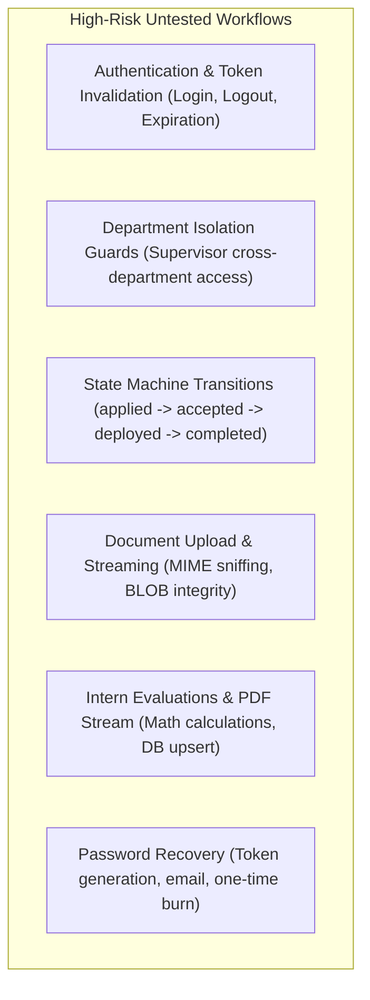

# Testing and Quality Assurance Assessment

**Audit Scope:** Inspection of automated test suites, testing configurations, CI test pipelines, syntax validation, and code verification at commit `83aa34f`.

---

## 1. Existing Test Maturity

| Area | Status | Evidence / Observation |
|---|---|---|
| **Unit Tests** | **Non-existent (0%)** | No `tests/` directory, no `*Test.php` files, and no testing framework (PHPUnit/Pest) is installed or vendored. |
| **Integration Tests** | **Non-existent (0%)** | No automated tests verify database interactions, session lifecycles, or API endpoint request/response contracts. |
| **End-to-End (E2E) Tests** | **Non-existent (0%)** | No browser automation tools (Cypress, Playwright, Selenium) exist to validate multi-step applicant or supervisor flows. |
| **Security Regression Tests**| **Non-existent (0%)** | No automated tests exist to detect broken access control, unauthenticated API calls, or IDOR regressions. |
| **Continuous Integration (CI)**| **Non-existent (0%)** | No `.github/workflows/` or pipeline configurations exist to run automated checks on git push or pull request. |
| **Test Data / Seed Fixtures** | **Manual Only** | Only the static `config/database.sql` script exists, which seeds 1 super admin, 9 departments, and 4 roles. No repeatable testing fixtures exist. |

---

## 2. Safe Syntax Validation Executed During Phase 0

In accordance with Phase 0 audit rules, non-destructive syntax verification was executed across the tracked codebase:

### A. PHP Static Linting (`php -l`)
- **Total Tracked PHP Files Checked:** 78 files (46 in `api/`, 6 in `pages/`, 6 in root, 4 in `lib/`, 16 in `lib/fpdf/`, 3 in `lib/phpmailer/`).
- **Result:** **100% Passed** with zero syntax errors.
  ```text
  No syntax errors detected in api/*.php
  No syntax errors detected in pages/*.php
  No syntax errors detected in session-manager.php, audit-logger.php, index.php
  No syntax errors detected in lib/*.php
  ```

### B. JavaScript Syntax Validation (`node --check`)
- **Total Tracked JS Files Checked:** 9 files (`assets/js/*.js`).
- **Result:** **100% Passed** with valid ECMAScript syntax and no lexical parsing errors.

---

## 3. High-Risk Untested Workflows

The complete absence of automated testing leaves critical institutional workflows vulnerable to regressions:



1. **Authentication & Session State:**
   - Multiple login endpoints (`login.php`, `admin-login.php`, `student-login.php`) create sessions through divergent code paths. No test verifies that revoked or expired sessions return HTTP 401 across all endpoints.
2. **Horizontal Department Data Isolation:**
   - Department supervisors must only access candidates within their assigned department. No automated test asserts that a supervisor from "Health" receives an HTTP 403 when requesting records or documents from "ICT".
3. **Application Lifecycle Transitions:**
   - No test verifies whether an applicant can bypass intermediate states (e.g. jumping directly from `applied` to `deployed`), or whether rejected applications can be maliciously revived.
4. **Document Integrity & Storage:**
   - Files are stored as database BLOBs. No test verifies that files up to 2 MB upload without binary corruption or that non-PDF/PNG MIME types are rejected.
5. **Schema Synchronization:**
   - Endpoints containing schema bugs (such as `change-password.php` referencing `password` instead of `password_hash`) went undetected due to the absence of automated integration tests.

---

## 4. Recommended Target Testing Strategy (Phased Plan)

To transition the Vuka Portal into an enterprise-grade institutional system, an automated testing harness must be introduced starting in Phase 1:

### A. Testing Stack Recommendation
- **PHP Backend:** PHPUnit 10+ (via Composer).
- **HTTP/API Testing:** PHPUnit with `GuzzleHttp` or native cURL against a dedicated test database (`vuka_test_db`).
- **Database Fixtures:** Transactional test runner that seeds clean roles, departments, and test users, rolling back after each test case.
- **Frontend / Integration:** Playwright or Cypress for core applicant submission and supervisor deployment workflows.

### B. Immediate Priority Test Suites Required for Phase 1 & 2
1. **Security & Auth Suite (`tests/Security/`):**
   - Assert anonymous requests to `api/get-submissions.php` and `api/update-submission.php` return HTTP 401.
   - Assert expired and invalidated tokens are rejected.
   - Assert `debug_code` is absent from registration responses.
   - Assert rate limiting locks out an IP after 5 consecutive failed attempts.
2. **Access Control Suite (`tests/RBAC/`):**
   - Assert Department Supervisors can only read/update submissions matching their department.
   - Assert Students cannot view or modify other students' applications.
   - Assert Super Admin and HR can access all departments (`ALL` scope).
3. **Workflow Suite (`tests/Workflow/`):**
   - Test full student registration → verification → application submission → supervisor review → accept → deployment → evaluation.
